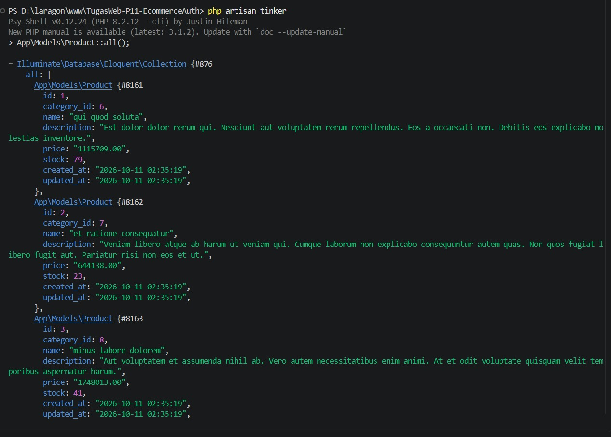
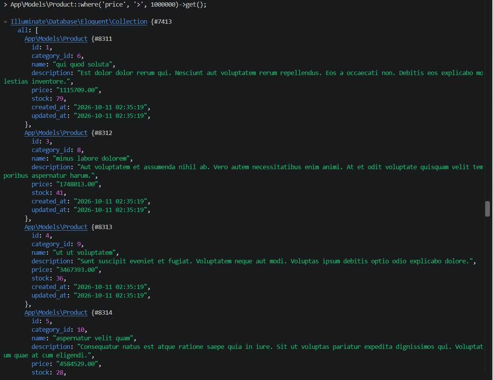
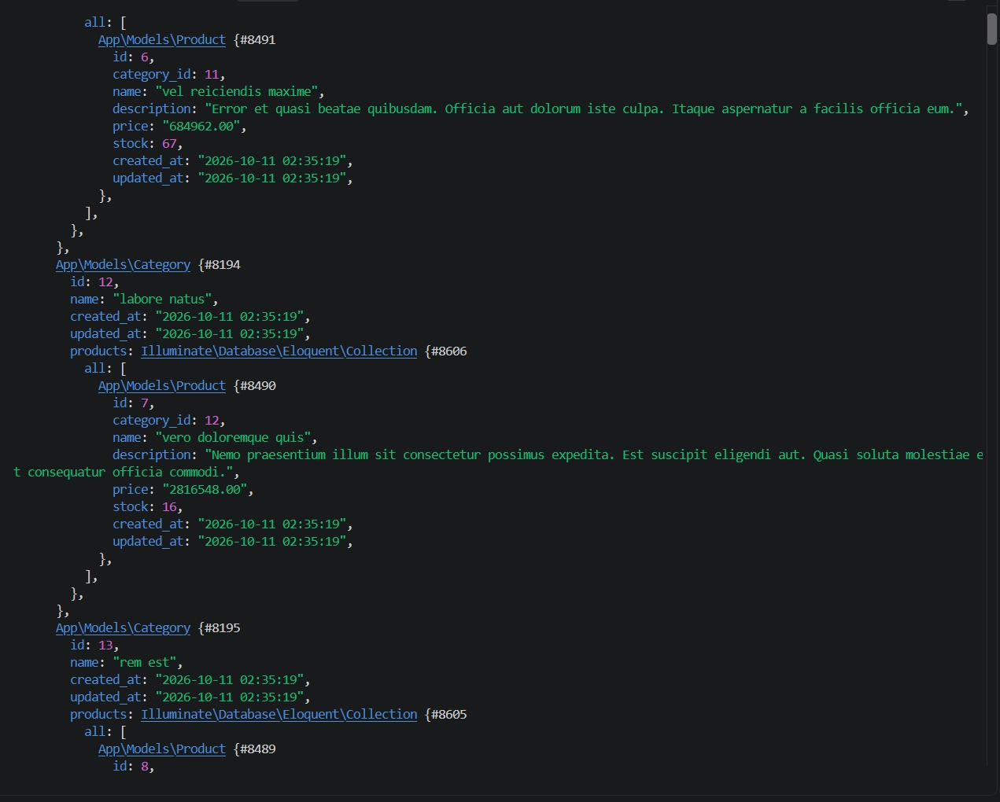
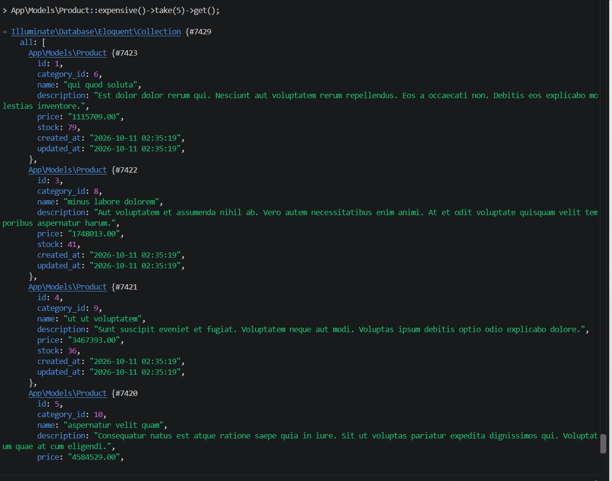
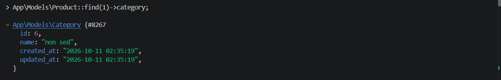
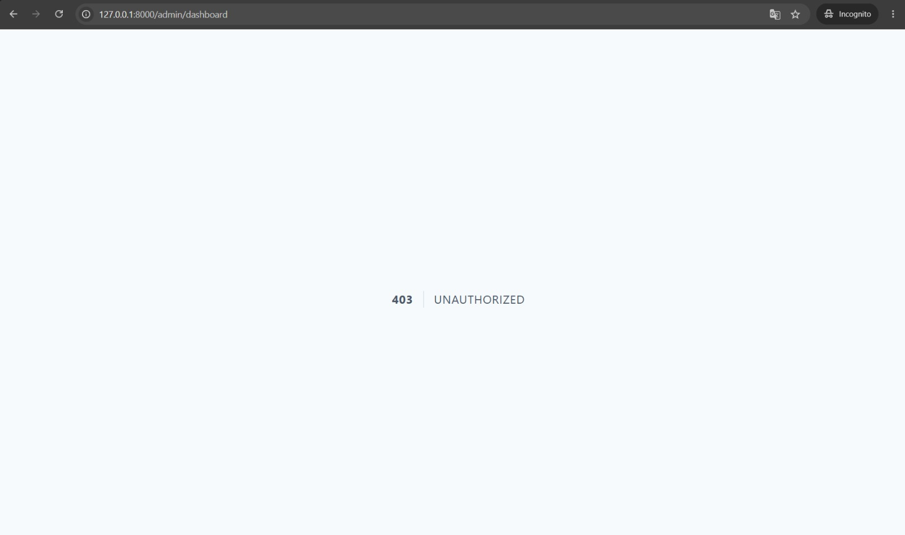
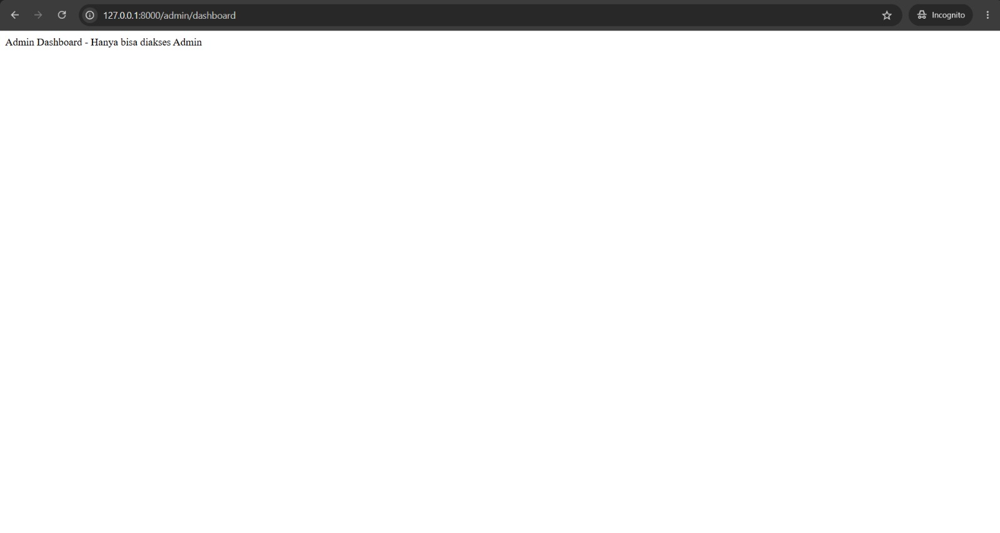
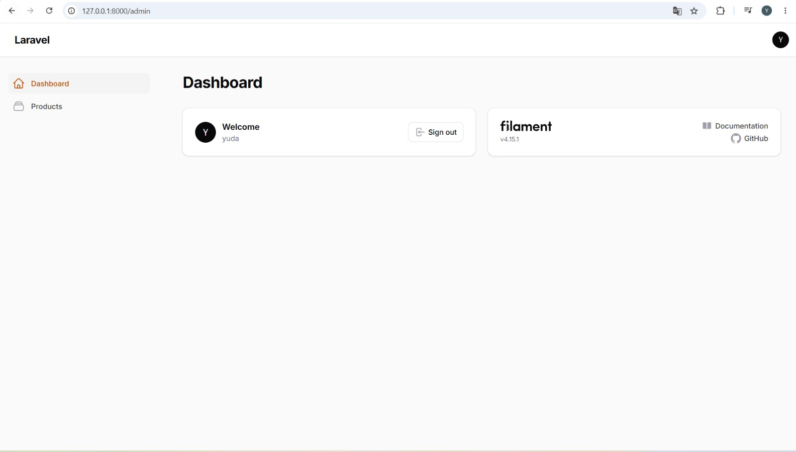
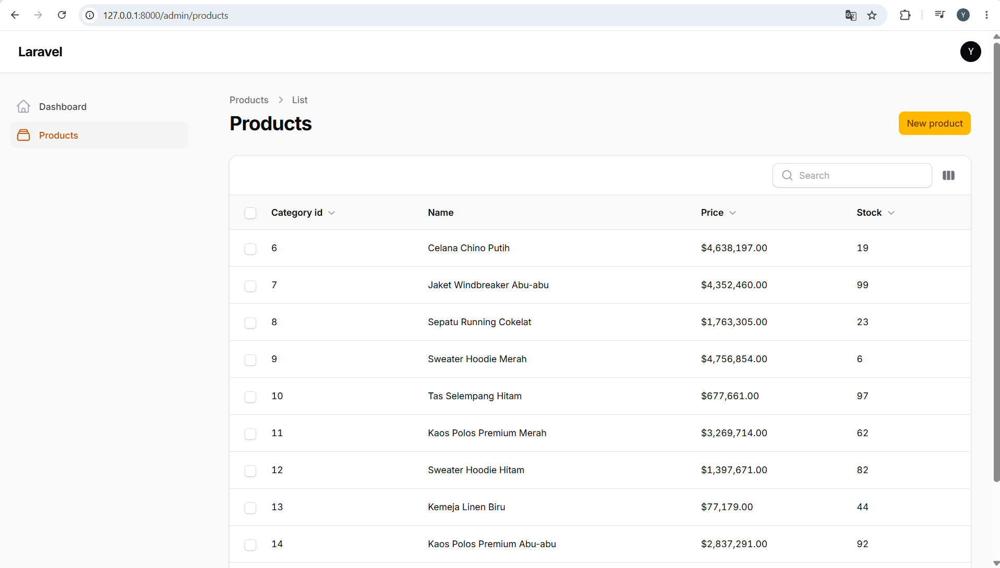

# Tugas Web Pertemuan 11 - E-Commerce DB + Secure Auth

Repositori ini dibuat untuk memenuhi Tugas Rutin 11: E-Commerce DB + Secure Auth.

## 🛠️ Bagian A - Database & Eloquent
### 1. Migrations, Models, & Seeders
Telah berhasil membuat 7 tabel migrasi dengan foreign key constraints, serta mengisi data produk menggunakan Seeder & Factory (55 produk).

### 2. Dokumentasi 5 Query Tinker
Berikut adalah bukti screenshot dari 5 query Eloquent yang dijalankan melalui Tinker:

**1. Mengambil semua produk (`Product::all()`)**

**2. Filter harga di atas 1.000.000 (`Product::where(...)`)**

**3. Eager loading kategori & produk (`Category::with(...)`)**

**4. Menggunakan Scope `expensive()`**

**5. Mengambil kategori dari produk (`Product::find(1)->category`)**

## 🔐 Bagian B - Auth & Security
### 1. Route Protection & Multi-role Middleware
Berikut adalah bukti pengujian hak akses menggunakan 2 role (Admin dan User Biasa) di Incognito:

**User Biasa mencoba mengakses `/admin/dashboard` (Gagal - 403 Unauthorized)**

**Admin mengakses `/admin/dashboard` (Berhasil)**

### 2. PostPolicy
Telah dibuat `ProductPolicy` untuk membatasi aksi edit dan delete produk hanya untuk role admin dan editor.

## 🌟 Bonus - Filament Admin Panel
Telah berhasil menginstall Filament v4 dan menggenerate resource untuk model Product.

**Dashboard Filament**

**Daftar Produk di Filament (dengan Eager Loading `with('category')`)**
